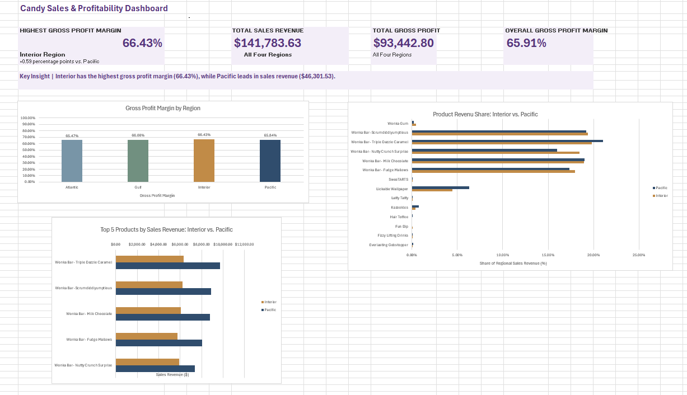

# Candy Sales & Profitability Analysis

## Project Overview
This project analyzes candy distributor sales data to evaluate regional performance, product revenue, and gross profit margins. The goal was to identify opportunities to improve profitability while maintaining strong sales performance.

## Tools & Skills
- Microsoft Excel
- PivotTables and PivotCharts
- Data analysis and visualization
- KPI development
- Gross profit margin analysis
- Business insights and recommendations

## Dashboard

## Key Findings
- **Total Sales Revenue:** $141,783.63
- **Total Gross Profit:** $93,442.80
- **Overall Gross Profit Margin:** 65.91%
- **Highest Regional Gross Profit Margin:** Interior at 66.43%
- **Highest Regional Sales Revenue:** Pacific at $46,301.53

The Interior region achieved a gross profit margin 0.59 percentage points higher than the Pacific region, despite Pacific generating more revenue.

## Additional Analysis
I investigated whether product sales mix could help explain differences in regional profitability.

Wonka Bar – Triple Dazzle Caramel represented approximately 21.02% of Pacific sales revenue and had a gross profit margin of approximately 65.33%.

Excluding this product increased Pacific's gross profit margin only slightly, from 65.84% to 65.98%. This suggests that the product alone does not explain the regional profitability difference.

## Business Recommendation
Investigate opportunities to increase sales of higher-margin products alongside popular candy bars, rather than reducing sales of products that already generate substantial revenue.

## Project Files
- `candy_sales_profitability_portfolio.xlsx` — Excel analysis and dashboard
- `candy_sales_dashboard.png` — Dashboard preview

